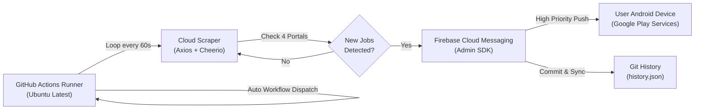

# 📡 DevScout — Mobile Developer Job & Freelance Radar
### رادار هوشمند و آنی فرصت‌های شغلی و پروژه‌ای فلاتر و اندروید

[](https://flutter.dev)
[](https://dart.dev)
[](https://nodejs.org)
[](https://firebase.google.com)
[](https://github.com/features/actions)
[](https://blog.cleancoder.com)
[](https://opensource.org/licenses/MIT)

---

## 🌐 زبان‌ها / Languages
- [🇮🇷 توضیحات و مستندات فارسی](#-توضیحات-فارسی-persian)
- [🇬🇧 English Documentation](#-english-documentation)

---

# 🇮🇷 توضیحات فارسی (Persian)

## 📖 معرفی پروژه (DevScout چیست؟)

**DevScout** یک پلتفرم جامع و رادار هوشمند است که با هدف رصد لحظه‌ای فرصت‌های شغلی و پروژه‌های فریلنسری توسعه‌دهندگان موبایل (**Flutter** و **Android**) در بازار کار ایران توسعه یافته است.

در بازار کار توسعه نرم‌افزار، سرعت در ارسال اولین پیشنهاد یا رزومه (First-to-Apply Advantage) نقشی حیاتی در موفقیت فریلنسرها و کارجویان دارد. با این حال، سر زدن مداوم به ۴ سایت مختلف کاریابی وقت‌گیر بوده و بستن برنامه‌ها در اندروید به دلیل سیاست‌های صرفه‌جویی باتری، مانع از اجرای اسکرپرهای پس‌زمینه محلی می‌شد.

**DevScout** این مشکل را با یک معماری دوگانه حل کرده است:
1. **اپلیکیشن کلاینت مدرن (Flutter):** طراحی بر پایه Clean Architecture و BLoC با فونت فارسی «مربا»، مدیریت کامل فیلترها، کش آفلاین و متد نیتیو اندروید جهت دور زدن محدودیت‌های تحریم/فیلترشکن.
2. **موتور ابری ۲۴/۷ (Cloud Scraper & FCM):** یک بات سبک Node.js که روی سرورهای ابری GitHub Actions به‌طور دائم با حلقه ۶۰ ثانیه‌ای اجرا شده و با استفاده از **Firebase Cloud Messaging (FCM)** نوتیفیکیشن‌ها را حتی در حالت بسته بودن کامل اپلیکیشن، در کمتر از ۱ دقیقه مستقیماً به نوار اعلان گوشی کاربر ارسال می‌کند.

---

## 🔍 پلتفرم‌های کاریابی تحت پوشش

| منبع | دسته‌بندی در اپ | نحوه استخراج (Scraping Strategy) | نوع فرصت‌ها |
| :--- | :---: | :--- | :--- |
| **پونیشا (Ponisha.ir)** | فریلنسری | استخراج Hydration State از تگ `__NEXT_DATA__` | پروژه‌ای، قیمت ثابت، مناقصه فریلنسری |
| **کارلنسر (Karlancer.com)** | فریلنسری | تجزیه وضعیت انگولار از اسکریپت `ng-state` | پروژه‌ای، تمام‌وقت و پاره‌وقت |
| **جابینجا (Jobinja.ir)** | استخدامی | اسکرپینگ زنده HTML به همراه استخر پراکسی ایران و متد نیتیو دور زدن WAF | استخدامی، کارآموزی، ریموت و حضوری |
| **جاب‌ویژن (JobVision.ir)** | استخدامی | اتصال مستقیم به REST API بخش کارجویان (`candidateapi.jobvision.ir`) | استخدامی شرکتی، تمام‌وقت، هیبرید |

---

## ✨ قابلیت‌ها و ویژگی‌های کلیدی

### ۱. ⚡ نوتیفیکیشن آنی ابری (مشابه تلگرام و بدون مصرف باتری)
- بر خلاف اپلیکیشن‌های سنتی که وابسته به `WorkManager` گوشی هستند و به دلیل حالت Doze Mode اندروید ساعت‌ها تاخیر دارند، DevScout از **معماری پوش نوتیفیکیشن واقعی سرور به کلاینت (FCM v1)** استفاده می‌کند.
- حتی اگر گوشی در حالت استندبای باشد، اینترنت قطع و وصل شود یا برنامه به‌طور کامل Force Close شده باشد، اعلان با اولویت بالا (`High Priority`) ظرف کمتر از ۶۰ ثانیه همراه با صدا و ویبره ظاهر می‌شود.

### ۲. 🛡️ بای‌پس هوشمند فایروال آروان‌کلود و VPN روی اندروید
- سایت جابینجا به دلیل تنظیمات امنیتی WAF آروان‌کلود، درخواست‌های خارج از کشور و IPهای متصل به VPN را با خطای `403 Forbidden` مسدود می‌کند.
- DevScout در کد نیتیو کاتلین (`MainActivity.kt`) با بهره‌گیری از قابلیت `NET_CAPABILITY_NOT_VPN` در `ConnectivityManager` اندروید، ترافیک درخواست‌های جابینجا را به‌صورت خودکار از کارت شبکه وای‌فای یا سیم‌کارت داخلی ایران عبور می‌دهد. کاربر نیازی به خاموش کردن فیلترشکن خود ندارد.

### ۳. 🗂️ تب‌بندی هوشمند فرصت‌ها
- **تب فریلنسری (Freelance):** تجمیع پروژه‌های دارای سقف بودجه، مناقصه و تعداد پیشنهاد از پونیشا و کارلنسر.
- **تب استخدامی (Employment):** تجمیع آگهی‌های حقوق‌دار، تمام‌وقت، پاره‌وقت و شرکتی از جابینجا و جاب‌ویژن.

### ۴. 🎯 سیستم فیلترهای چندگانه و جستجوی آنی
- فیلتر بر اساس تخصص: **همه فرصت‌ها**، **فلاتر (Flutter)**، **اندروید (Android / Kotlin)**.
- فیلتر بر اساس نوع همکاری: **فقط دورکاری (Remote Only)**.
- فیلتر اختصاصی بر اساس هر منبع با نمایش زنده تعداد آگهی‌های فعال در هر سایت.
- فیلتر آگهی‌های نشان‌شده (Bookmarked).
- نوار جستجوی متنی لحظه‌ای در عنوان، نام کارفرما، مهارت‌ها و متن توضیحات با قابلیت پاک‌سازی سریع.

### ۵. 🎨 طراحی بصری زیبا با تایپوگرافی بومی «مربا»
- مجهز به تایپوگرافی اصیل با فونت فارسی **مربا (Morabba)** در اوزان مختلف.
- رابط کاربری مدرن، نشانگرهای وضعیت رنگی برای هر پلتفرم (رنگ برند پونیشا، کارلنسر، جابینجا و جاب‌ویژن).
- سازگاری کامل با حالت تاریک (Dark Mode) و روشن (Light Mode) و ساختار راست‌به‌چپ (RTL).
- نمایش تاریخ‌های نسبی دقیق به فارسی (مثلاً «۵ دقیقه پیش»، «امروز»، «دیروز») و فرمت‌بندی تومان.

### ۶. 🔗 دیپ‌لینکینگ و بوک‌مارک آفلاین
- ذخیره‌سازی آگهی‌های برگزیده در دیتابیس محلی با دسترسی سریع حتی در حالت آفلاین.
- پشتیبانی از Deep Link با اسکیم `jobradar://job?id=...&url=...` برای باز شدن مستقیم صفحه جزئیات آگهی از نوتیفیکیشن.
- دکمه هدایت مستقیم به صفحه اصلی آگهی در سایت مبدا جهت ثبت پیشنهاد یا ارسال رزومه.

---

## 🏗️ معماری نرم‌افزار و الگوهای طراحی

پروژه DevScout با رعایت اصول **Clean Architecture** در سه لایه کاملاً مجزا پیاده‌سازی شده است:

```
lib/
├── core/                       # ابزارها، قالب، مسیریابی و سرویس‌های سراسری
│   ├── di/                     # تزریق وابستگی با get_it (Service Locator)
│   ├── localization/           # متن‌ها و محلی‌سازی فارسی
│   ├── router/                 # هدایت و مسیریابی صفحات با go_router
│   ├── services/               # سرویس‌های FCM، نوتیفیکیشن محلی و دیپ‌لینک
│   └── theme/                  # تم‌های دارک و لایت با تایپوگرافی فونت Morabba
├── data/                       # منابع داده، مدل‌ها و مخازن
│   ├── datasources/            # اسکرپرهای ریموت (Dart Scraper) و کش لوکال (SharedPreferences)
│   ├── models/                 # مدل‌های داده‌ای JSON و مپرها
│   └── repositories/           # پیاده‌سازی اینترفیس‌های لایه دامنه
├── domain/                     # لایه خالص بیزینس لاجیک (بدون وابستگی به فریم‌ورک)
│   ├── entities/               # انتیتی‌های اصلی Job و ScrapeSummary
│   ├── repositories/           # قراردادها و اینترفیس‌های مخازن داده
│   └── usecases/               # UseCaseهای دریافت کش، اسکرپ زنده و تغییر بوکمارک
└── presentation/               # لایه رابط کاربری (UI)
    ├── bloc/                   # مدیریت وضعیت با BLoC و رویدادهای مربوطه
    ├── pages/                  # صفحات اصلی (Home, Splash, Details, Settings)
    └── widgets/                # کامپوننت‌های ماژولار (JobCard, Drawer, FilterPills)
```

---

## 🤖 موتور اعلان ابری (`backend_notifier/`)

در پوشه `backend_notifier/` یک اسکرپر ۲۴ ساعته قرار دارد که بدون نیاز به سرور فیزیکی، بر روی **GitHub Actions** اجرا می‌شود:



- **حلقه ۶۰ ثانیه‌ای:** اجرای مداوم در نشست‌های طولانی بدون ایجاد وقفه.
- **خودزنجیره‌سازی (Self-Chaining):** به محض اتمام یک نشست ۵ ساعته، ورک‌فلو بعدی بلافاصله از طریق GitHub REST API آغاز به کار می‌کند.
- **جلوگیری از اعلان تکراری:** شناسه‌های مشاغل بررسی‌شده در فایل `history.json` ذخیره و روی گیت ثبت می‌شوند.
- **کش و استخر پراکسی:** در صورت قطع موقت اتصال جابینجا، از استخر پراکسی‌های فعال ایران و فایل `jobinja_cache.json` استفاده می‌شود.

---

## 🚀 راهنمای نصب و اجرای محلی

### پیش‌نیازها
- نصب [Flutter SDK](https://flutter.dev/docs/get-started/install) نسخه 3.24 یا بالاتر
- نصب [Android Studio](https://developer.android.com/studio) با Android SDK 34+
- نصب [Node.js](https://nodejs.org) نسخه 18 یا بالاتر (برای اجرای بخش نوتیفایر)

### اجرای اپلیکیشن فلاتر
```bash
# ۱. کلون کردن مخزن
git clone https://github.com/Lilfibonacci/DevScout.git
cd DevScout

# ۲. دریافت پکیج‌های فلاتر
flutter pub get

# ۳. اتصال گوشی یا شبیه‌ساز اندروید و اجرای برنامه
flutter run
```

### اجرای دستی موتور نوتیفایر ابری (Node.js)
```bash
cd backend_notifier

# نصب پکیج‌های مورد نیاز
npm install

# قرار دادن کلید اختصاصی فایربیس (serviceAccountKey.json) در همین پوشه
# تست ارسال اعلان به گوشی
node test_push.js

# اجرای یک دور اسکرپ کامل
node index.js
```

---

<br/>

---

# 🇬🇧 English Documentation

## 📖 Overview

**DevScout** is an intelligent, real-time job and project radar tailored specifically for **Flutter** and **Android** mobile developers targeting the Iranian freelance and employment markets.

In fast-paced freelance and tech job ecosystems, applying within the first few minutes of a job posting dramatically increases hireability. DevScout solves fragmentation and delay by aggregating leading tech platforms into a single unified mobile hub, paired with a server-to-client 24/7 cloud notification engine.

---

## 🔍 Tracked Job Portals

| Platform | Category | Extraction Mechanism | Opportunities |
| :--- | :---: | :--- | :--- |
| **Ponisha (ponisha.ir)** | Freelance | Next.js Hydrated State parsing (`__NEXT_DATA__`) | Fixed price, milestones, client bidding |
| **Karlancer (karlancer.com)** | Freelance | Angular state extraction (`ng-state`) | Project-based, remote, contracts |
| **Jobinja (jobinja.ir)** | Employment | HTML DOM scraping with Iran proxy pool & native WAF bypass | Full-time, remote, internship positions |
| **JobVision (jobvision.ir)** | Employment | Direct REST API (`candidateapi.jobvision.ir`) | Enterprise positions, hybrid, salaries |

---

## ✨ Key Features

- **⚡ Telegram-Grade Instant Push Notifications:**
  Runs an independent 24/7 cloud scraper on GitHub Actions / Node.js. When a job is posted, an FCM v1 high-priority notification arrives on the user's phone in **under 60 seconds**, even if the app is force-closed or the phone screen is locked.
- **🛡️ Native Android VPN/WAF Bypass:**
  Jobinja's ArvanCloud WAF restricts foreign IPs and commercial VPN connections (returning HTTP 403). DevScout utilizes a custom Kotlin MethodChannel in `MainActivity.kt` leveraging `NET_CAPABILITY_NOT_VPN` in Android's `ConnectivityManager`, routing Jobinja network calls exclusively through local cellular/Wi-Fi interfaces regardless of active VPNs.
- **🗂️ Clean Dual-Tab Segmentation:**
  Distinct workspaces for **Freelance Projects** (Ponisha & Karlancer) versus **Full-time Employment** (Jobinja & JobVision).
- **🎯 Multi-criteria Filtering & Instant Search:**
  Filter by technology stack (All, Flutter, Android), Work Mode (Remote only), platform source, or saved bookmarks. Search titles, tags, and company names with debounced live filtering.
- **🎨 Modern Persian Typography & Native UX:**
  Powered by the **Morabba** font family with complete RTL support, dark/light theme switching, and Persian Toman currency formatting.
- **🔗 Deep Linking & Bookmarks:**
  Custom URI scheme `jobradar://job?id=...` launches individual job details directly from notification trays. Offline persistent bookmarking with `shared_preferences`.

---

## 🏛️ System Architecture

DevScout adheres to **Clean Architecture** and SOLID principles:

- **Domain Layer:** Pure Dart entities (`JobEntity`, `ScrapeSummaryEntity`), repository contracts, and use cases. Free of framework dependencies.
- **Data Layer:** Remote scrapers (`JobRemoteDataSourceImpl`) with resilient HTTP clients and isolate workers, combined with local persistent storage (`JobLocalDataSourceImpl`).
- **Presentation Layer:** State management orchestrated via **BLoC** (`flutter_bloc`), declarative routing with `go_router`, and service locator dependency injection via `get_it`.

---

## 🛠️ Tech Stack & Libraries

### Client Application (Flutter)
- **Framework:** Flutter 3.47+ (Dart 3.13+)
- **State Management:** `flutter_bloc` & `equatable`
- **Dependency Injection:** `get_it`
- **Navigation:** `go_router`
- **Networking & Parsing:** `http`, `html`, `intl`
- **Notifications:** `firebase_core`, `firebase_messaging`, `flutter_local_notifications`
- **System & Storage:** `shared_preferences`, `url_launcher`, `app_links`, `workmanager`

### Cloud Notifier Service (`backend_notifier/`)
- **Runtime:** Node.js 20 LTS
- **Scraping Engine:** `axios`, `cheerio`
- **Push Engine:** `firebase-admin` (HTTP v1 API)
- **CI/CD Automation:** GitHub Actions with self-chaining `workflow_dispatch` runners.

---

## 🚀 Getting Started

### Prerequisites
- [Flutter SDK](https://flutter.dev) (v3.24+)
- [Android Studio](https://developer.android.com/studio) with SDK 34+
- [Node.js](https://nodejs.org) (v18+)

### Running the Flutter App
```bash
# Clone the repository
git clone https://github.com/Lilfibonacci/DevScout.git
cd DevScout

# Fetch Flutter dependencies
flutter pub get

# Launch on connected Android device or emulator
flutter run
```

### Running the Cloud Notifier Locally
```bash
cd backend_notifier
npm install

# Place your Firebase service account key as serviceAccountKey.json
# Test FCM push dispatch
node test_push.js

# Run a single scrape & notify cycle
node index.js
```

---

## 📄 License

This project is licensed under the [MIT License](LICENSE).

---

<p align="center">
  Crafted with ❤️ for the Iranian Flutter & Android Developer Community.
</p>
